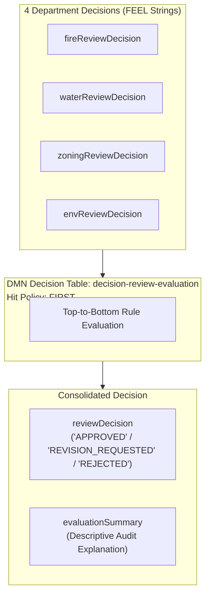

# Camunda 8 DMN (Decision Model and Notation) Guide
## CivicFlow – Municipal Building Permit Management System

---

## 1. What is DMN and Why is it Used in CivicFlow?

**DMN 1.3 (Decision Model and Notation)** is the industry standard for modeling operational business rules. 

In Camunda 8, DMN separates **decision logic** from **process orchestration**:
- **BPMN** controls the sequence, timing, gateways, and human user tasks (the *"flow"*).
- **DMN** executes complex business rules and decision matrices declaratively (the *"logic"*).

In CivicFlow, DMN is implemented in two critical stages of the permit lifecycle:
1. **Multi-Department Review Evaluation Matrix** (`review-decision-matrix.dmn`): Decides whether an application is `APPROVED`, `REVISION_REQUESTED`, or `REJECTED` based on four independent departmental findings.
2. **Municipal Permit Fee Tariff Matrix** (`permit-fee-matrix.dmn`): Computes statutory rates, scrutiny charges, floor surcharges, and environmental cess based on building category, built-up area, and floors.

---

## 2. Decision Table 1: Multi-Department Review Decision Matrix

- **File**: `civicflow/camunda/dmn/review-decision-matrix.dmn`
- **Decision ID**: `decision-review-evaluation`
- **Hit Policy**: `FIRST` (Evaluates rules from top to bottom; the first rule where all inputs match fires, and evaluation completes).
- **BPMN Invocation**: Business Rule Task `Task_EvaluateReviews` (`<bpmn:businessRuleTask>`) in `municipal_building_permit_process.bpmn`.

### Decision Table Inputs & Outputs



### Rule Logic (Decision Table Matrix)

| Rule | Fire Decision | Water Decision | Zoning Decision | Env Decision | Output: `reviewDecision` | Output: `evaluationSummary` |
|---|---|---|---|---|---|---|
| **R1** | `"REJECTED"` | `-` | `-` | `-` | `"REJECTED"` | *"Application rejected due to Fire Safety & Life Safety non-compliance"* |
| **R2** | `-` | `"REJECTED"` | `-` | `-` | `"REJECTED"` | *"Application rejected due to Water supply or Sewerage grid infeasibility"* |
| **R3** | `-` | `-` | `"REJECTED"` | `-` | `"REJECTED"` | *"Application rejected due to Master Plan zoning or setback violation"* |
| **R4** | `-` | `-` | `-` | `"REJECTED"` | `"REJECTED"` | *"Application rejected due to environmental buffer or green cover violation"* |
| **R5** | `"REVISION_REQUESTED"` | `-` | `-` | `-` | `"REVISION_REQUESTED"` | *"Applicant must submit modified drawings resolving Fire Safety comments"* |
| **R6** | `-` | `"REVISION_REQUESTED"` | `-` | `-` | `"REVISION_REQUESTED"` | *"Applicant must submit revised plumbing, drainage or STP scheme"* |
| **R7** | `-` | `-` | `"REVISION_REQUESTED"` | `-` | `"REVISION_REQUESTED"` | *"Applicant must modify building setbacks or FAR drawings"* |
| **R8** | `-` | `-` | `-` | `"REVISION_REQUESTED"` | `"REVISION_REQUESTED"` | *"Applicant must submit revised green cover or waste management scheme"* |
| **R9** | `"APPROVED"` | `"APPROVED"` | `"APPROVED"` | `"APPROVED"` | `"APPROVED"` | *"All four municipal departments granted technical clearance. Proceeding to fee calculation."* |

> [!NOTE]
> **Why Hit Policy `FIRST`?**
> A municipal rejection has priority over a revision request. If the Zoning department rejects an application due to an illegal road encroachment, but the Water department requested a minor pipe revision, Rule R3 matches first and instantly rejects the application without subjecting the citizen to futile revisions.

---

## 3. Decision Table 2: Municipal Permit Fee Tariff Matrix

- **File**: `civicflow/camunda/dmn/permit-fee-matrix.dmn`
- **Decision ID**: `decision-permit-fee-matrix`
- **Hit Policy**: `FIRST`
- **BPMN Invocation**: Business Rule Task `Task_EvaluateFeeMatrix` in the fee calculation Call Activity (`municipal_fee_calculation_process.bpmn`).

### Inputs:
1. `buildingType` (string: `"RESIDENTIAL"`, `"COMMERCIAL"`, `"INDUSTRIAL"`)
2. `proposedBuiltUpArea` (number: square feet)
3. `floors` (number of storeys)

### Outputs:
1. `baseRatePerSqFt` (number: INR rate per sq.ft.)
2. `scrutinyFee` (number: mandatory document scrutiny charge)
3. `floorSurchargeRate` (number: percentage surcharge multiplier for multi-storey loads)
4. `environmentalCessRate` (number: green protection levy percentage)

### Rule Logic (Decision Table Matrix)

| Rule | Building Type | Built-Up Area (sq.ft.) | Floors | Base Rate (₹/sq.ft) | Scrutiny Fee (₹) | Floor Surcharge | Green Cess |
|---|---|---|---|---|---|---|---|
| **R1 (Low-Density Residential)** | `"RESIDENTIAL"` | `&le; 2000` | `&le; 2` | **₹25** | **₹2,000** | 0% | 2% |
| **R2 (Multi-Storey Residential)** | `"RESIDENTIAL"` | `-` | `-` | **₹30** | **₹3,500** | 10% | 2% |
| **R3 (Small Commercial)** | `"COMMERCIAL"` | `&le; 5000` | `-` | **₹50** | **₹5,000** | 15% | 3% |
| **R4 (Large Commercial / Mall)** | `"COMMERCIAL"` | `> 5000` | `-` | **₹65** | **₹10,000** | 20% | 4% |
| **R5 (Industrial / Plant)** | `"INDUSTRIAL"` | `-` | `-` | **₹40** | **₹7,500** | 15% | 5% |

---

## 4. How DMN is Evaluated in Camunda 8 Zeebe

In Camunda 8, DMN evaluation does **NOT** require a separate worker or external script:
1. Zeebe contains a built-in, highly optimized **FEEL (Friendly Enough Expression Language)** execution engine.
2. When the token enters a `<bpmn:businessRuleTask>`:
   ```xml
   <bpmn:businessRuleTask id="Task_EvaluateReviews" name="Evaluate Department Decisions (DMN)">
     <bpmn:extensionElements>
       <zeebe:calledDecision decisionId="decision-review-evaluation" resultVariable="reviewDecision" />
     </bpmn:extensionElements>
   </bpmn:businessRuleTask>
   ```
3. Zeebe evaluates the decision table in memory with sub-millisecond latency.
4. The output variables (`reviewDecision`, `feeMatrix`) are saved directly into the process instance and evaluated immediately by subsequent Exclusive Gateways.

---

## 5. How to Show DMN to Your Teacher

### In Camunda Desktop Modeler:
1. Open Camunda Desktop Modeler.
2. Click **File &rarr; Open File**.
3. Select:
   - `civicflow/camunda/dmn/review-decision-matrix.dmn`
   - `civicflow/camunda/dmn/permit-fee-matrix.dmn`
4. The Modeler displays the Decision Table with colored input columns (blue), output columns (green), and rule descriptions.

### In Camunda Operate:
1. Log in to `http://localhost:8080/operate` (`demo` / `demo`).
2. Click on **"Decisions"** in the top navigation bar.
3. Your teacher will see:
   - `decision-review-evaluation`
   - `decision-permit-fee-matrix`
4. Click on any decision instance to view the **Decision Audit Trail**, showing exactly which inputs were provided, which rule fired, and the resulting output!
