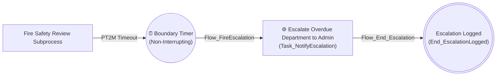
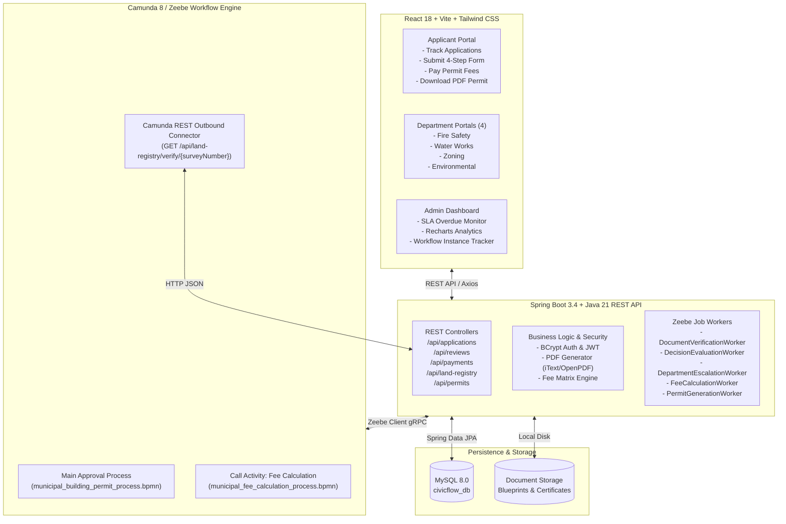
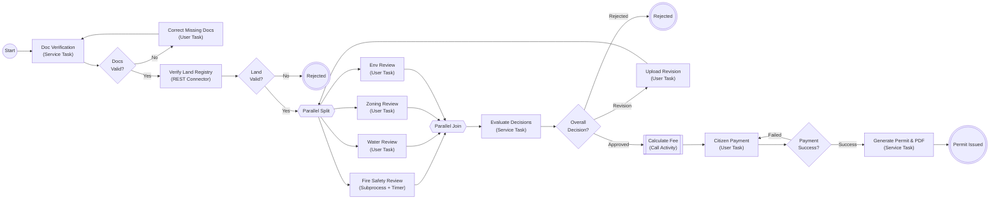
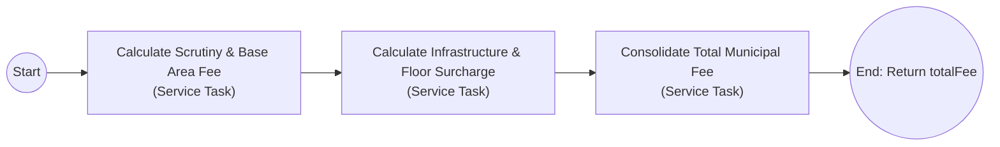

# CivicFlow – Municipal Building Permit Management System
## Complete System Architecture & Camunda 8 BPMN Workflow Guide

---

## 1. Focused Explanation: Review Timeout Escalation Timer

### Where is it leading to and what does it do?



#### A. What is it?
In the BPMN 2.0 specification and Camunda 8, this element (`Timer_FireEscalation`) is a **Non-Interrupting Boundary Timer Event** (`cancelActivity="false"`) attached to the boundary of the **Fire Safety Department Review** subprocess.

#### B. What does it do?
1. **SLA Monitoring**: Under municipal regulations, each department is allocated a strict review window (48 hours in real-world governance; configured to `PT2M` / 2 minutes in this academic project for live demonstration).
2. **Non-Interrupting Behavior**:
   - Because it has a **double dashed ring** (`cancelActivity="false"`), triggering this timer **does NOT kill, cancel, or interrupt** the Fire Safety review task.
   - The Fire Safety Officer can still review, inspect blueprints, and submit their decision without interruption.
   - Instead, the timer spawns a parallel **escalation token** to handle the delay administratively.

#### C. Where is it leading to?
The outgoing sequence flow (`Flow_FireEscalation`) leads directly into:
1. **Service Task: `Task_NotifyEscalation` ("Escalate Overdue Department to Admin")**:
   - Executed by Spring Boot worker: `DepartmentEscalationWorker.java` (`type="department-escalation-worker"`).
   - Flags the application in the MySQL database as `IS_OVERDUE = TRUE` with `OVERDUE_DEPARTMENT = 'FIRE_SAFETY'`.
   - Generates an **Audit Log Entry** recording the SLA breach.
   - Raises an escalation alert badge on the **Municipal Administrator Dashboard** (`/admin`), enabling the Admin to reassign the task or issue an administrative reminder.
2. **End Event: `End_EscalationLogged`**:
   - Terminates the escalation path cleanly once the alert has been dispatched.
   - Does not affect the main sequence flow where the application continues through the remaining departmental reviews.

---

## 2. End-to-End Working of the CivicFlow Project

CivicFlow is an enterprise-grade e-governance platform for municipal corporations. It bridges citizens, municipal departments, and municipal administrators through event-driven workflow automation.



---

## 3. Detailed Walkthrough: Main Camunda 8 BPMN Workflow

The primary process definition is located at `civicflow/camunda/bpmn/municipal_building_permit_process.bpmn`.



### Stage-by-Stage Breakdown

#### Stage 1: Application Ingestion & Document Verification
- **Start Event (`StartEvent_ApplicationSubmitted`)**:
  - Instantiated when the citizen submits the 4-step application form in the React frontend.
  - Passes payload variables: `applicationId`, `applicantName`, `surveyNumber`, `buildingType`, `plotArea`, `proposedBuiltUpArea`, `floors`, `hasBlueprint`, `hasLandTitle`, `hasStructuralCert`.
- **Service Task: `Task_DocumentVerification`**:
  - Bound to worker: `document-verification-worker`.
  - Validates that mandatory documents (blueprints, land deed, structural stability cert) are uploaded and legible.
  - Sets process variable: `documentsValid = true / false`.
- **Exclusive Gateway: `Gateway_DocVerification`**:
  - If `documentsValid == false`: Routes to `Task_CorrectMissingDocuments` (User Task). Once the applicant re-uploads files, it loops back to `Task_DocumentVerification`.
  - If `documentsValid == true`: Proceeds to Land Registry Verification.

#### Stage 2: Land Registry & GIS Verification (Camunda REST Outbound Connector)
- **Task: `Task_LandRegistryVerification`**:
  - Implemented as an official **Camunda 8 Outbound HTTP Connector** (`io.camunda.connectors.HttpJson.v2`, template version 11).
  - Makes an automated HTTP `GET` request to:
    `http://localhost:8081/api/land-registry/verify/{{surveyNumber}}`
  - Zero Java glue code required in Camunda engine—the connector natively parses the JSON response using FEEL:
    `={landRegistryValid: response.body.valid, landRegistryMessage: response.body.message, ownershipStatus: response.body.ownershipStatus}`
- **Exclusive Gateway: `Gateway_LandVerification`**:
  - If `landRegistryValid == false`: Application is disputed or encroached; routes to `EndEvent_LandRejected`.
  - If `landRegistryValid == true`: Proceeds to Parallel Department Reviews.

#### Stage 3: Parallel Departmental Review (Parallel Gateway Split)
- **Parallel Gateway (`Gateway_ParallelReviewsSplit`)**:
  - Divides execution into 4 simultaneous, independent branches.
- **Branch 1: Fire Safety Review Subprocess (`SubProcess_FireReview`)**:
  - Contains User Task `Task_FireSafetyReview`.
  - Equipped with Non-Interrupting Boundary Timer `Timer_FireEscalation` (`PT2M` demo duration).
  - If 2 minutes elapse without a review, escalation alerts are logged to the Admin without halting the review.
- **Branch 2: Water Department Review (`Task_WaterReview`)**:
  - User Task for water connection feasibility, pipeline pressure, and sewage disposal.
- **Branch 3: Zoning Department Review (`Task_ZoningReview`)**:
  - User Task for setbacks, floor area ratio (FAR), height clearance, and road width compliance.
- **Branch 4: Environmental Review (`Task_EnvReview`)**:
  - User Task for rainwater harvesting, green cover percentage, and waste management.

#### Stage 4: Synchronizing Reviews & Consolidated Decision
- **Parallel Join Gateway (`Gateway_ParallelReviewsJoin`)**:
  - Waits until **all 4 departments** have submitted their official decisions (`APPROVED`, `REJECTED`, or `REVISION_REQUESTED`).
- **Service Task: `Task_EvaluateReviews` (`evaluate-decisions-worker`)**:
  - Consolidates all four decisions:
    1. If **any department rejected** &rarr; `reviewDecision = "REJECTED"`
    2. Else if **any department requested revision** &rarr; `reviewDecision = "REVISION_REQUESTED"`
    3. If **all 4 departments approved** &rarr; `reviewDecision = "APPROVED"`
- **Exclusive Gateway: `Gateway_OverallDecision`**:
  - `REJECTED` &rarr; Routes to `EndEvent_DeptRejected`.
  - `REVISION_REQUESTED` &rarr; Routes to User Task `Task_ApplicantRevision` ("Applicant Uploads Revised Blueprint"). When submitted, loops back into `Gateway_ParallelReviewsSplit` for re-review.
  - `APPROVED` &rarr; Proceeds to Fee Calculation.

#### Stage 5: Fee Calculation (Reusable Call Activity)
- **Call Activity: `CallActivity_FeeCalculation`**:
  - Spawns an independent child workflow instance: `Process_MunicipalFeeCalculation`.
  - Passes building parameters (`buildingType`, `plotArea`, `proposedBuiltUpArea`, `floors`).
  - Executes municipal tiered rate formulas and returns `totalFee`, `scrutinyFee`, `infrastructureFee`, and `environmentalCess`.

#### Stage 6: Citizen Payment & Retry Loop
- **User Task: `Task_CitizenPayment`**:
  - The applicant views the breakdown on `/payment/:id` and processes payment via the mock payment gateway (Credit Card, Net Banking, UPI).
- **Exclusive Gateway: `Gateway_PaymentStatus`**:
  - If `paymentSuccess == false` (e.g. simulated card decline): Loops back to `Task_CitizenPayment` allowing the citizen to retry.
  - If `paymentSuccess == true`: Generates payment transaction reference and proceeds.

#### Stage 7: Digital Permit Generation & Issuance
- **Service Task: `Task_GeneratePermit` (`permit-generation-worker`)**:
  - Computes a cryptographically signed SHA-256 digital verification seal.
  - Produces a downloadable official PDF building permit featuring:
    - Official municipal coat of arms / municipal seal
    - Unique Permit Number (e.g. `BLD-2026-XXXXX`)
    - Property, Survey, and Applicant specifics
    - Individual approval timestamps from all 4 departments
    - QR verification hash code
- **End Event (`EndEvent_PermitIssued`)**:
  - Completes the workflow instance and notifies the applicant via email/portal alert.

---

## 4. Reusable Call Activity: Fee Calculation Process

Process file: `civicflow/camunda/bpmn/municipal_fee_calculation_process.bpmn`



### Rate Matrix Formula:
- **Residential**: Base rate = ₹25 / sq.ft.
- **Commercial**: Base rate = ₹50 / sq.ft.
- **Industrial**: Base rate = ₹40 / sq.ft.
- **Floor Surcharge**: Extra 10% per floor above 3 floors.
- **Environmental Cess**: 2% flat of base fee.

---

## 5. User Roles and Security Matrix

| Feature | Citizen / Architect | Department Officers | Municipal Administrator |
|---|---|---|---|
| **Submit New Permit Application** | ✅ Full Access | ❌ Restricted | ❌ Restricted |
| **Upload Documents / Blueprints** | ✅ Full Access | ❌ Read Only | ❌ Read Only |
| **Track Workflow Timeline** | ✅ Own Applications | ❌ Assigned Only | ✅ All Municipal Cases |
| **Review & Approve/Reject** | ❌ Restricted | ✅ Department Specific | ❌ Audit View |
| **Request Blueprint Revision** | ❌ Restricted | ✅ Department Specific | ❌ Audit View |
| **SLA Overdue Escalation View** | ❌ Restricted | ❌ Restricted | ✅ Full Access |
| **Make Application Fee Payment** | ✅ Full Access | ❌ Restricted | ❌ Audit Only |
| **Download PDF Permit with QR** | ✅ Approved Only | ✅ Read Only | ✅ Full Access |
| **System Audit Logs & Recharts** | ❌ Restricted | ❌ Restricted | ✅ Full Access |

---

## 6. How to Run and Demo the Entire Project

### Step 1: Database Setup
Ensure MySQL is running on port 3306:
```sql
CREATE DATABASE civicflow_db;
-- Schema and demo seeds are automatically loaded from:
-- civicflow/backend/database/schema.sql
-- civicflow/backend/database/seed.sql
```

### Step 2: Camunda 8 Engine
Ensure standalone Camunda 8 Run (`c8run`) or Camunda Cloud / Desktop Modeler is operational:
- Zeebe Gateway: `localhost:26500`
- Operate: `http://localhost:8080` (credentials: `demo` / `demo`)

### Step 3: Start Spring Boot Backend
```powershell
cd "d:\Workflow Project\civicflow\backend"
mvn spring-boot:run
```
- Backend REST API will start at: `http://localhost:8081`
- Auto-deploys both BPMN workflows to Camunda 8 upon boot.

### Step 4: Start React Frontend
```powershell
cd "d:\Workflow Project\civicflow\frontend"
npm run dev
```
- Access the web application at: `http://localhost:3000`

### Demo Credentials:
- **Citizen / Architect**: `rahul.sharma@example.com` / `password123`
- **Fire Safety Officer**: `fire.officer@civicflow.gov.in` / `officer123`
- **Water Works Officer**: `water.officer@civicflow.gov.in` / `officer123`
- **Zoning Officer**: `zoning.officer@civicflow.gov.in` / `officer123`
- **Environmental Officer**: `env.officer@civicflow.gov.in` / `officer123`
- **Municipal Administrator**: `admin@civicflow.gov.in` / `admin123`
